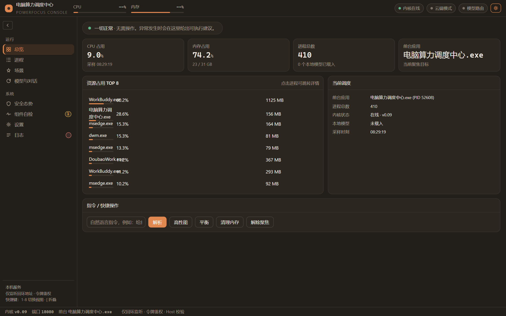
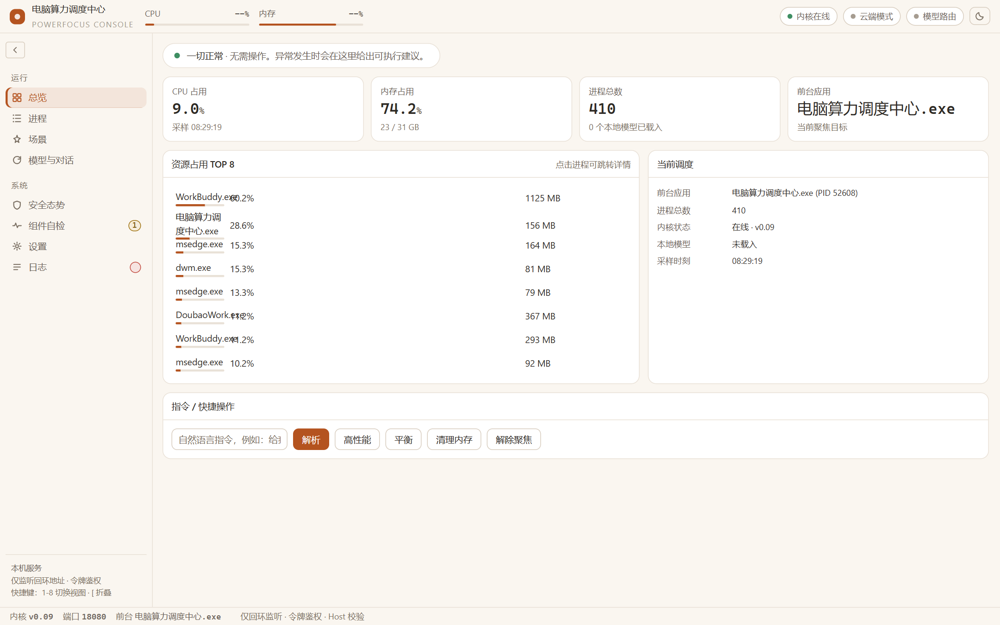

# PowerFocus · 电脑算力调度中心

[English README](README_EN.md) · [MCP 接入](mcp/README.md) · [版本规则](docs/VERSION_POLICY.md) · [更新日志](CHANGELOG.md) · [使用教程](docs/user-guide.md)

一个 Windows 桌面算力调度工具，把「任务管理器 + 调度台 + 对话控制」塞进同一个窗口。
选中任何进程，就能给它让路、提优先级、回收内存、冻结恢复；嫌点来点去麻烦，
也可以直接对输入框说人话，由它翻译成调度指令。另带一条**真实运行的病毒扫描链路**
（可选能力，详见下文「安全扫描」）。

> 诚实定位：这是个人开发者维护的开源项目。代码（Python / PowerShell / HTML）为项目原创；
> 项目**不包含任何第三方二进制**——卡巴斯基 KVRT、Node.js 等第三方组件均由应用在用户明确同意后
> 从官方源下载到本机，详见 [THIRD_PARTY_NOTICES.md](THIRD_PARTY_NOTICES.md)。

## 界面预览

下面两张是总览页的实机截图（深色 / 浅色主题，数据为真实采样）：





## 核心特性

- **进程调度**：聚焦三档（温和 / 强制 / 极限）、优先级调整、内存回收、冻结恢复、终止（二次确认）。
- **授权白名单**：首次调度某应用前需加入授权清单，清单外目标一律拒绝；敏感操作需本机令牌。
- **自然语言控制**：中文指令离线规则解析优先，LLM 兜底；敏感命令（授权 / 撤销）永远不经 LLM 生成。
- **场景模式与规则引擎**：游戏 / 工作 / 全力等场景预设一键切换，规则驱动自动调度。
- **模型路由**：本地推理服务与云端 API 双通道，凭据经 DPAPI 加密存储。
- **安全扫描（可选）**：经用户同意后从卡巴斯基官方源下载 KVRT 扫描引擎，应用内验签、真实扫描、
  解析官方报告；支持多引擎识别与适配（详见下文）。

## 安全扫描链路（真实，非模拟）

v0.10 内核起，应用具备应用内病毒扫描能力。这不是模拟出来的演示——全链路实测跑通过，
6,943 个扫描对象是真扫出来的：

1. **下载**：仅从卡巴斯基官方分发点获取 KVRT（免费专有工具），落到应用自身目录。
2. **验签**：纯 Python 调用 `WinVerifyTrust` + SHA256 校验，不依赖外部工具。
3. **扫描**：真实调用引擎执行自定义范围或全盘扫描，默认只报告、不删除文件。
4. **报告**：解析 KVRT 官方编码报告并落盘，应用内可查看与调度（每日自动扫描可配置）。
5. **多引擎适配**：识别本机已装的 Defender / 卡巴斯基 KES / ESET 等并统一接口；
   「识别 ≠ 可调用」，未经实测的引擎拒绝执行。

边界声明：**KVRT 不随本仓库或安装包分发**；卡巴斯基完整版只下载验签、由用户本人在官方向导安装；
扫描结果仅供参考，不替代专业安全软件（详见[免责声明](#免责声明)）。

## 架构简图

```
┌────────────────────────────────────────────────────────────┐
│  桌面端 product/v1.00（WebView2 单页控制台，七页导航）          │
│  总览 · 进程 · 场景 · 模型与对话 · 安全态势 · 设置 · 日志        │
└───────────────┬────────────────────────────────────────────┘
                │ HTTP（仅 127.0.0.1，令牌鉴权）
┌───────────────▼────────────────────────────────────────────┐
│  应用服务 app/server.py + security.py（FastAPI / uvicorn）    │
│  组件自检 · 引擎适配 · 模型路由 · 凭据 DPAPI 加密              │
└───────────────┬────────────────────────────────────────────┘
                │ JSON 命令总线（commands/in → done → out）
┌───────────────▼────────────────────────────────────────────┐
│  调度内核 versions/<当前版本>（PowerShell 7）                 │
│  进程调度 · 白名单 · 规则引擎 · 场景 · NL 解析 · 安全扫描模块     │
└────────────────────────────────────────────────────────────┘
```

## 使用文档

下载后怎么用、每个界面是干什么的、常见任务分步教程、故障排查、卸载方法——
都在 [docs/user-guide.md](docs/user-guide.md)（用户手册）里。

## 快速开始（从源码运行）

环境要求：Windows 10 / 11，Python 3.13+（含 pip），PowerShell 7（pwsh），
Microsoft Edge WebView2 Runtime（Win11 自带）。

```powershell
# 1. 克隆仓库
git clone <仓库地址> PowerFocus
cd PowerFocus

# 2. 创建并激活虚拟环境
python -m venv .venv
.\.venv\Scripts\Activate.ps1

# 3. 安装运行依赖
pip install fastapi uvicorn httpx psutil pywebview

# 4. 运行桌面端（product/v1.00 源码形态）
python product\v1.00\app\main.py
```

打包为独立 exe（可选，需 PyInstaller）：

```powershell
cd product\v1.00
.\build\build.ps1 -Clean    # 产物输出到 dist\电脑算力调度中心.exe
```

## 版本机制

- `versions/` 存放调度内核的各历史版本（v0.05 … v0.10），`versions/current.json`
  指向当前生效内核；根目录的 `电脑算力调度中心.ps1` 是跟随该指针的兼容转发壳。
- `product/v1.00/` 是桌面端产品（源码 + 打包 + 安装脚本），依赖内核 ≥ v0.07。
  产品版本与内核版本是两条线，互不影响。
- 变更历史见 [CHANGELOG.md](CHANGELOG.md)；开发日志见 `DEVELOPMENT_LOG.md`。

## 安全模型

- **只监听回环地址**：服务绑定 `127.0.0.1`，不开放局域网，无远程控制。
- **令牌鉴权**：接口需令牌访问，破坏性操作二次确认且需本机 token。
- **白名单动作**：写操作全部走内核白名单动作，后端不允许任意命令透传；
  不操作 PPL 保护的系统进程（lsass、csrss 等）。
- **数据落盘位置**：运行态数据统一写入 `%LOCALAPPDATA%\PowerFocus`，不写 Program Files，
  不写系统目录、注册表、服务或计划任务。
- **第三方组件获取原则**：应用只「提供安装能力」——缺什么先列给用户，用户点头同意后
  由应用进程从官方源下载并验签，绝不预置、绝不静默安装。

## 免责声明

- 本项目的病毒扫描结果**仅供参考**，不能替代专业安全软件的实时防护。
  KVRT 官方条款亦明确该工具「不用于长期持续防护」。
- 破坏性操作（终止进程、施压、清除）天然带风险，操作前请确认目标；
  重要工作请随时保存。
- 本软件按「现状」提供，不附带任何明示或默示的担保。使用风险由使用者自行承担，
  详见 [LICENSE](LICENSE) 的担保免责与责任限制条款。
- 本项目与卡巴斯基、Microsoft、Node.js 基金会等第三方无任何隶属或背书关系；
  各商标归其各自所有者所有。
- **数据流向如实说明**：本地快照（进程/资源数据）仅存于本机 `%LOCALAPPDATA%`，不上传；
  使用云端模型对话时，你的输入内容由**你自己配置的第三方模型服务商**按其隐私政策处理，
  本项目不经手、不存储、不转发该内容。
- 本工具仅限用于**你拥有合法权限的计算机**；不得用于未授权控制或干扰他人的计算机系统。
- 本项目的合规自查记录见 [docs/legal-review.md](docs/legal-review.md)，
  竞品与定位分析见 [docs/competitive-analysis.md](docs/competitive-analysis.md)。

## 参与贡献

欢迎 Issue 与 Pull Request，请先阅读 [CONTRIBUTING.md](CONTRIBUTING.md)。
发现安全漏洞请勿公开提交，按 [SECURITY.md](SECURITY.md) 的渠道报告。
社区行为规范见 [CODE_OF_CONDUCT.md](CODE_OF_CONDUCT.md)。

## 许可

代码以 [Apache License 2.0](LICENSE) 发布。第三方组件的许可与使用方式见
[THIRD_PARTY_NOTICES.md](THIRD_PARTY_NOTICES.md)。
